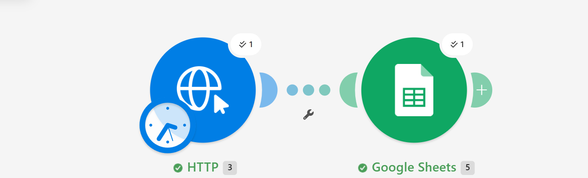
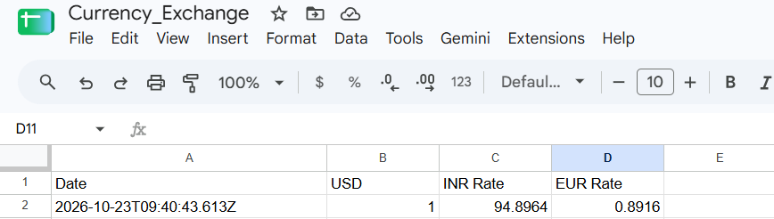

# RateRelay-Automated-USD-Exchange-Rate-Logger

## Preview



*The Make.com scenario: an HTTP module fetches the latest USD rates, then Google Sheets adds a new row.*



*Each run appends a timestamped row with the USD, INR and EUR rates.*

> A no-code Make.com scenario that fetches live USD exchange rates from an API and logs them, timestamped, into Google Sheets, ready for Power BI.


---

## About

**RateRelay** is a workflow automation that removes the manual work of tracking currency exchange rates. On every run it calls the ExchangeRate-API, picks out the USD to INR and USD to EUR rates, and appends them as a new row in a Google Sheet along with a timestamp.

The sheet becomes a continuously growing, clean exchange-rate history that can feed a Power BI dashboard, so currency conversions always use up-to-date rates instead of hardcoded numbers.

Built as **Project 2** of the Codebasics AI Automations course (API-based automation), following the n8n-based Project 1.

## Description

### The problem
Finance and sales dashboards often convert revenue between currencies using a static rate typed in by hand. The rate goes stale, the numbers drift, and someone has to remember to update it.

### The manual process this replaces
1. Open a browser and search for the current exchange rate
2. Copy the rates
3. Paste them into a spreadsheet with the date
4. Repeat, every day

### The solution
A two-module Make.com scenario that does this automatically:

| Step | Module | What it does |
|------|--------|--------------|
| 1 | **HTTP, Make a request** | Sends a `GET` request to ExchangeRate-API's `latest/USD` endpoint and receives all USD-based rates as JSON |
| 2 | **Google Sheets, Add a Row** | Maps the timestamp and selected rates into a new row in the `Currency_Exchange` sheet |

### Workflow

```
 ┌───────────────┐      ┌──────────────────────┐      ┌────────────────────┐
 │   Scheduler   │ ───▶ │  HTTP: GET request   │ ───▶ │  Google Sheets:    │
 │ (Make.com)    │      │  ExchangeRate-API    │      │  Add a Row         │
 └───────────────┘      │  /v6/<key>/latest/USD│      │  Currency_Exchange │
                        └──────────────────────┘      └────────────────────┘
                                                                │
                                                                ▼
                                                        Power BI dashboard
```

## Output

Each run appends one row to the `Currency_Exchange` Google Sheet:

| Date | USD | INR Rate | EUR Rate |
|------|-----|----------|----------|
| 2026-10-23T09:40:43.613Z | 1 | 94.8964 | 0.8916 |

- **Date**: ISO 8601 timestamp (UTC) of the run
- **USD**: base currency, always `1`
- **INR Rate**: units of INR per 1 USD
- **EUR Rate**: units of EUR per 1 USD

## Tech Stack

- **Make.com**: workflow orchestration and scheduling
- **ExchangeRate-API (v6)**: exchange rate data source
- **Google Sheets**: storage layer / lightweight data store
- **Power BI** (downstream): consumes the sheet for dynamic currency conversion

## Setup Guide

### Prerequisites
- A free [Make.com](https://www.make.com) account
- A free [ExchangeRate-API](https://www.exchangerate-api.com) key
- A Google account with a Google Sheet ready

### 1. Prepare the Google Sheet
Create a sheet named `Currency_Exchange` with these headers in row 1:

```
Date | USD | INR Rate | EUR Rate
```

### 2. Create the scenario in Make.com
Create a new scenario and add two modules.

### 3. Configure the HTTP module
- **Module:** HTTP, *Make a request*
- **Version:** 4
- **URL:** `https://v6.exchangerate-api.com/v6/YOUR_API_KEY/latest/USD`
- **Method:** `GET`
- **Parse response:** Yes

> Keep your API key private. Do not commit it to GitHub or share screenshots that show it.

### 4. Configure the Google Sheets module
- **Module:** Google Sheets, *Add a Row*
- Connect your Google account and select the `Currency_Exchange` spreadsheet and sheet
- Map the columns:

| Column | Mapped value |
|--------|--------------|
| Date | `{{now}}` |
| USD | `1` (static) |
| INR Rate | `{{2.data.conversion_rates.INR}}` |
| EUR Rate | `{{2.data.conversion_rates.EUR}}` |

*(Module numbers may differ in your scenario; pick the fields from the HTTP module's output in the mapping panel.)*

### 5. Test, then schedule
1. Click **Run once** and confirm the HTTP module returns status `200` and a new row appears in the sheet
2. Set the schedule and switch the scenario **On**:
   - **Daily at 8:00 AM**: recommended for a dashboard
   - **Every 15 minutes**: handy while testing, but it uses your free-plan operations quickly and the API's free tier only refreshes rates about once a day

### 6. Connect Power BI
In Power BI, use *Get Data → Web / Google Sheets* (published CSV link) to load the `Currency_Exchange` sheet, then use the latest row as your conversion rate.

## Results

- Fully hands-off exchange-rate collection
- Clean, timestamped, Power BI-ready data
- No more hardcoded conversion rates
- Built entirely without code


## Learnings

- Calling a REST API with Make's HTTP module and reading the JSON response
- Mapping nested JSON fields into spreadsheet columns
- Scheduling scenarios and managing operation limits
- Designing automation output so a BI tool can consume it directly


---

*If you found this useful, feel free to star the repo.*
